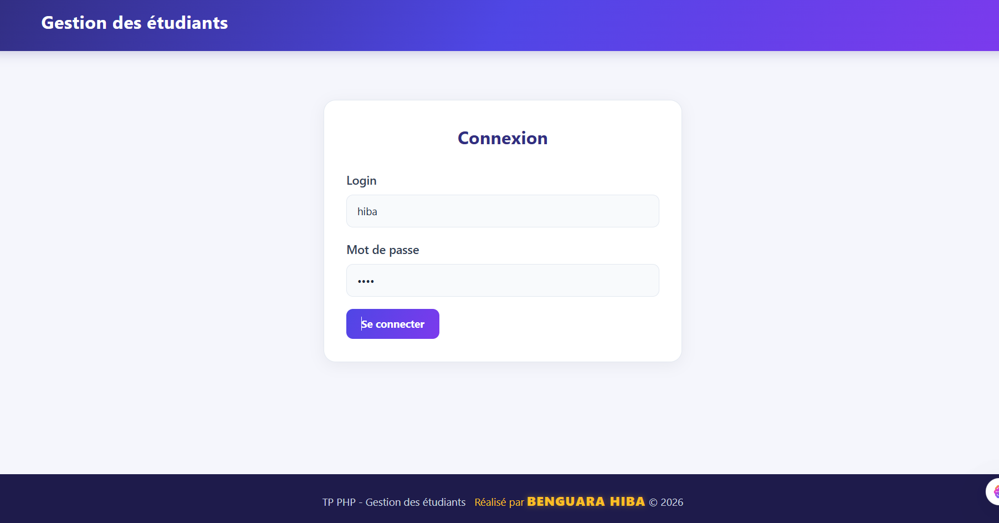
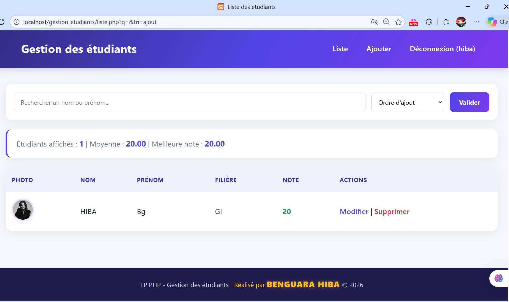
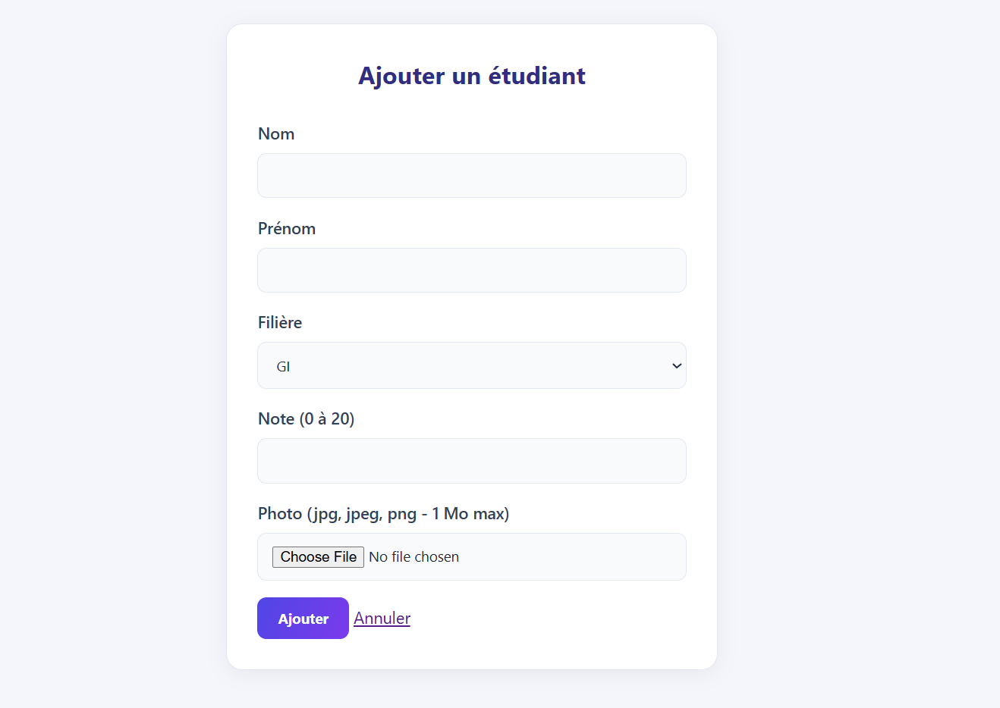

# Gestion des étudiants

**Réalisé par :** Hiba BENGUARA  
**Formation :** Génie Informatique  
**Établissement :** ENSAs   
**Année universitaire :** 2026–2027


## 1. Présentation du projet

Dans le cadre de ce TP, j'ai réalisé une application web de gestion des étudiants en utilisant PHP, HTML, CSS et JavaScript.

L'objectif de ce projet est de faciliter la gestion des informations des étudiants à travers une interface simple et facile à utiliser.

L'application permet notamment d'ajouter, d'afficher, de rechercher, de trier, de modifier et de supprimer des étudiants. J'ai également ajouté un système d'authentification pour protéger l'accès à l'application.

## 2. Technologies utilisées

Pour réaliser ce projet, j'ai utilisé les technologies suivantes :

- **PHP :** pour la gestion des données et le traitement des formulaires.
- **HTML5 :** pour structurer les différentes pages.
- **CSS3 :** pour créer une interface agréable et responsive.
- **JavaScript :** pour ajouter des interactions et améliorer l'expérience utilisateur.
- **XAMPP :** pour exécuter le projet en local avec Apache.

## 3. Fonctionnalités réalisées

J'ai développé plusieurs fonctionnalités :

- **Authentification :** connexion et déconnexion avec un login et un mot de passe.
- **Gestion des étudiants :** ajout, modification et suppression des étudiants.
- **Affichage :** présentation des étudiants dans un tableau.
- **Recherche :** recherche d'un étudiant par son nom ou son prénom.
- **Tri :** classement des étudiants par nom, filière, note ou ordre d'ajout.
- **Gestion des photos :** ajout et affichage des photos des étudiants.
- **Statistiques :** affichage du nombre d'étudiants, de la moyenne générale et de la meilleure note.
- **Messages de confirmation :** affichage de messages après certaines opérations.
- **Cookie « dernier login » :** le dernier identifiant utilisé est mémorisé pendant 7 jours.









## 4. Règles de validation

J'ai ajouté des contrôles pour éviter l'enregistrement de données incorrectes :

- Le nom et le prénom sont obligatoires.
- La filière doit appartenir à la liste proposée.
- La note doit être numérique et comprise entre 0 et 20.
- Les photos doivent respecter les formats autorisés (JPG, JPEG ou PNG).
- La taille maximale d'une photo est de 1 Mo.

## 5. Sécurité mise en place

- Protection contre les failles XSS avec `htmlspecialchars()` (fonction `h()`).
- Validation de toutes les données côté serveur.
- Conversion de l'identifiant en entier avec `(int)`.
- Contrôle de l'extension et de la taille des photos, renommage avec `uniqid()`.
- Pages protégées par `exiger_connexion()`.

## 6. Valeur ajoutée du projet

À travers ce projet, j'ai essayé de proposer une application simple, pratique et facile à utiliser.

J'ai notamment ajouté :
- Une interface organisée et responsive.
- Une recherche instantanée avec JavaScript.
- Un système de tri pour faciliter la consultation des étudiants.
- Des statistiques pour avoir une vue générale sur les résultats.
- Une gestion des photos pour rendre la liste plus claire et personnalisée.

## 7. Compétences acquises

La réalisation de ce projet m'a permis de mieux comprendre et de pratiquer plusieurs notions :

- La programmation côté serveur avec PHP.
- La manipulation des formulaires HTML.
- La gestion des sessions et des cookies.
- La lecture et l'écriture dans un fichier texte.
- La manipulation des tableaux en PHP.
- La validation et la sécurisation des données saisies.
- L'organisation d'un projet web en plusieurs fichiers.

## 8. Difficultés rencontrées

Pendant la réalisation du projet, j'ai rencontré quelques difficultés, notamment dans la gestion des sessions, la manipulation des fichiers et l'organisation des différentes pages PHP.

J'ai également dû faire attention aux chemins des fichiers, à l'affichage des données et à la gestion des photos.

Pour résoudre ces difficultés, j'ai testé les fonctionnalités progressivement et corrigé les erreurs au fur et à mesure.

- **Gestion des redirections et des headers :** j'ai veillé à placer les instructions `header()` et `setcookie()` avant tout affichage HTML afin d'éviter l'erreur « Headers already sent ». Par exemple, dans `index.php`, je vérifie d'abord si l'utilisateur est déjà connecté et, après une authentification réussie, je crée une session et un cookie avant de le rediriger vers `liste.php`.

## 9. Organisation des fichiers

Voici l'organisation de mon projet :
```
gestion_etudiants/
│
├── data/
│   └── etudiants.txt
│
├── uploads/
│   └── (photos des étudiants)
│
├── screenshots/
│   ├── connexion.png
│   ├── liste-etudiants.png
│   └── formulaire-etudiant.png
│
├── functions.php
├── header.php
├── footer.php
├── index.php
├── liste.php
├── ajouter.php
├── supprimer.php
├── logout.php
├── test.php
├── style.css
├── script.js
└── README.md
```

## 10. Stockage des données

J'ai choisi d'utiliser un fichier texte (`etudiants.txt`) pour stocker les informations des étudiants, sans utiliser de base de données.

Chaque étudiant est enregistré sur une ligne selon le format suivant :

```
id;nom;prenom;filiere;note;photo
```

Les photos des étudiants sont enregistrées séparément dans le dossier `uploads/`.

## 11. Installation et exécution

Pour exécuter mon projet en local, voici les étapes à suivre :

1. Installer XAMPP.
2. Démarrer le serveur Apache.
3. Copier le dossier `gestion_etudiants` dans le répertoire `htdocs` de XAMPP.
4. Ouvrir un navigateur.
5. Accéder à l'adresse suivante :

```
http://localhost/gestion_etudiants/
```

### Informations de connexion

- **Login :** hiba
- **Mot de passe :** 1234

## 12. Limites et améliorations possibles

Même si l'application répond aux objectifs du TP, certaines améliorations peuvent être envisagées :

- Utiliser une base de données MySQL au lieu d'un fichier texte.
- Améliorer la sécurité du système d'authentification en utilisant le hachage des mots de passe.
- Ajouter l'exportation des données au format CSV.
- Ajouter des statistiques par filière.
- Améliorer la gestion des utilisateurs avec différents rôles.

## 13. Conclusion

Ce TP m'a permis de mettre en pratique les notions étudiées en PHP et de mieux comprendre le fonctionnement d'une application web dynamique.

J'ai appris à organiser un projet, à manipuler les données, à gérer les formulaires et à ajouter des interactions avec JavaScript.

Cette expérience m'a également permis de développer ma capacité à résoudre des problèmes et à corriger les erreurs rencontrées pendant le développement.
